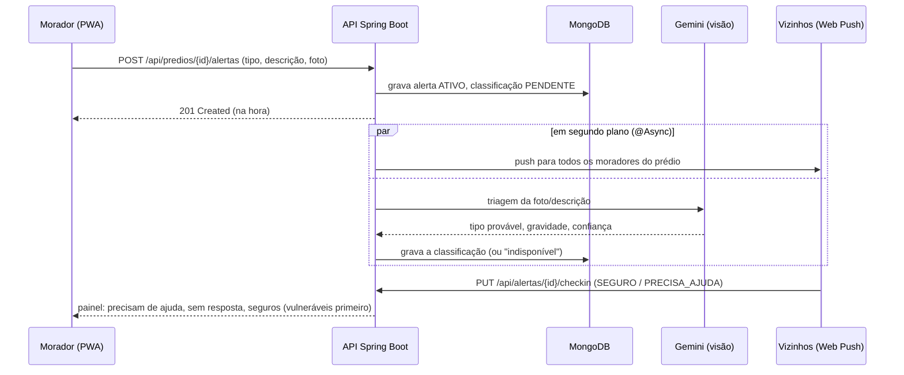
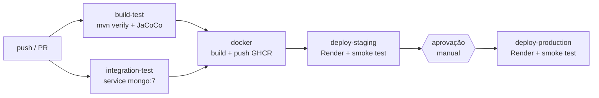

# FIAP CitizenTech

### AlertaPrédio

Alerta de emergência entre moradores de um mesmo prédio. Um toque no botão **EMERGÊNCIA** avisa
todos os vizinhos na hora (Web Push). Cada morador responde **Estou seguro** ou **Preciso de ajuda**,
e o síndico acompanha um painel em que quem tem necessidade especial aparece primeiro. Uma IA de visão
(Google Gemini) faz a triagem da foto e da descrição em segundo plano, **sem nunca atrasar o alerta**.

É um protótipo para apresentação: um MVP pequeno e bem testado, com o ciclo DevOps completo (API
Spring Boot + MongoDB, PWA, testes automatizados, Docker e pipeline CI/CD com staging e produção).

**Integrantes (2TDSOC):** Lucas Gabriel Neres Sant'Ana (RM 565612) · Matheus Ferreira da Costa (RM 564003)

**Ambientes publicados** (Render free: o primeiro acesso depois de um tempo parado pode levar cerca de 1 min):

| Ambiente | URL |
|---|---|
| Staging | <https://alerta-predio-staging.onrender.com> |
| Produção | <https://alerta-predio-prod.onrender.com> |

---

## Como funciona



### Regras de negócio

| Regra | Como é garantida |
|---|---|
| **O alerta nunca espera a IA** | O disparo grava, publica um evento e responde 201. Triagem e push são `@Async`. Se a IA falhar, demorar ou não tiver chave, a classificação fica `INDISPONIVEL` e o alerta segue normal |
| **Todos do prédio são avisados** | Push para todos os moradores do prédio, menos o autor e os removidos. Suspensos recebem normalmente |
| **Isolamento entre prédios** | Morador de outro prédio recebe **403** ao disparar, ver alerta, painel ou fazer check-in, e a tentativa vai para a auditoria |
| **Só o síndico encerra** | Encerramento com motivo: `REAL`, `FALSO_ENGANO` ou `FALSO_MA_FE` |
| **Advertência só por má-fé** | 1ª `FALSO_MA_FE` = advertência; 2ª = **botão suspenso por 30 dias**; 3ª = remoção do prédio. O suspenso **continua recebendo alertas e fazendo check-in** |
| **LGPD** | Necessidade especial é opcional e só é gravada com consentimento explícito (data e versão do termo). O telefone só aparece no painel para o síndico. O token de acesso é guardado só como hash SHA-256 |
| **Auditoria** | Ações sensíveis ficam numa trilha append-only: prédio criado, entrada, consentimento, disparo, disparo bloqueado, encerramento, advertência, suspensão, remoção, acesso negado |

### Modelo de dados (MongoDB)

| Collection | O que guarda |
|---|---|
| `predios` | Nome, endereço, `codigoConvite` (único, 6 caracteres sem ambíguos), síndico |
| `moradores` | Nome, apartamento, telefone, `papel` (MORADOR/SINDICO), `status` (ATIVO/ADVERTIDO/SUSPENSO/REMOVIDO), `qtdAdvertencias`, `suspensoAte`, `necessidadeEspecial` + `consentimento` (LGPD), hash do token, inscrições de push |
| `alertas` | Prédio, `autor` (nome e apto visíveis), `tipo` (INCENDIO, GAS, ALAGAMENTO, SOCORRO_MEDICO, ELEVADOR), descrição, `fotoUrl`, `status` (ATIVO/ENCERRADO), `confirmacoes`, `classificacao` da IA, `encerramento` (motivo e penalidade) |
| `checkins` | Alerta, morador, `situacao` (SEGURO/PRECISA_AJUDA), horário. Índice único (alerta, morador) |
| `auditoria` | Tipo do evento, prédio, quem fez, descrição, detalhes, horário |

A triagem assíncrona, as confirmações e o encerramento podem tocar o mesmo alerta ao mesmo tempo, por
isso cada um usa uma atualização atômica do próprio campo (`@Update` com `$set`/`$push` condicionais),
e não um `save` do documento inteiro.

---

## API REST

Documentação interativa em `/swagger-ui.html`. Crie um prédio ou entre com o código de convite, copie
o `token` da resposta e clique em **Authorize**: ele vai no header `X-Morador-Token`.

| Método e rota | Quem | O que faz |
|---|---|---|
| `POST /api/predios` | público | Cria o prédio; quem cria vira síndico e recebe o token |
| `POST /api/predios/entrar` | público | Entra com o código de convite e recebe o token |
| `GET /api/moradores/eu` | morador | Dados do morador do token e do prédio dele |
| `GET /api/predios/{id}` | membro | Prédio (o código de convite só aparece para o síndico) |
| `GET /api/predios/{id}/moradores` · `/auditoria` | síndico | Moradores com status/advertências · trilha de auditoria |
| `POST /api/predios/{id}/alertas` | membro não suspenso | **Dispara o alerta** (201 imediato) |
| `GET /api/predios/{id}/alertas?status=ATIVO` | membro | Alertas do prédio (sem a foto) |
| `GET /api/alertas/{id}` | membro | Alerta completo, com foto e classificação da IA |
| `POST /api/alertas/{id}/confirmacoes` | membro (não o autor) | Confirma que a emergência é real |
| `PUT /api/alertas/{id}/checkin` | membro (inclusive suspenso) | `SEGURO` ou `PRECISA_AJUDA` |
| `GET /api/alertas/{id}/painel` | membro | Quem está seguro, quem precisa de ajuda e quem não respondeu |
| `POST /api/alertas/{id}/encerramento` | síndico | Encerra com o motivo; `FALSO_MA_FE` aplica a penalidade |
| `GET /api/push/chave-publica` · `POST`/`DELETE /api/push/inscricoes` | público · morador | Web Push (VAPID) |
| `GET /api/demo/contas` | público, só com `SEED_ENABLED=true` | Tokens das contas do prédio de demonstração |
| `GET /api/info` · `GET /actuator/health` | público | Versão/ambiente (usado pelo smoke test) · health com o MongoDB |

Os erros saem como `ProblemDetail` (RFC 9457): 400 com os campos inválidos, 401 sem token, 403 acesso
negado, 404 e 409.

### IA de triagem

- `ClassificadorAlerta` é a interface. `ClassificadorAlertaFake` é determinístico e usa palavras-chave (padrão no ambiente local e nos testes). `ClassificadorGemini` chama `models/{modelo}:generateContent`, com a chave no header `x-goog-api-key` e resposta em JSON validada contra um schema com os enums.
- A foto do PWA vai como `inlineData`. Uma URL `http(s)` vai como `fileData`, então quem baixa a imagem é o Gemini e o servidor nunca busca URLs informadas pelo usuário.
- A descrição é tratada como dado, nunca como instrução, e a classificação é só uma sugestão: quem decide é o síndico.

| Variável | Padrão | Uso |
|---|---|---|
| `IA_PROVEDOR` | `fake` (local) / `gemini` (staging e prod) | Qual classificador usar |
| `GEMINI_API_KEY` | vazio | Chave do Google AI Studio; sem ela, a classificação fica "indisponível" |
| `GEMINI_MODELO` | `gemini-3.5-flash-lite` | Modelo de visão |

### Notificações (Web Push)

O envio é feito só com o JDK: assinatura VAPID ES256 (RFC 8292), criptografia `aes128gcm` (RFC 8291) e
`HttpClient`, sem bibliotecas de terceiros. Um teste confere a criptografia byte a byte contra o
exemplo oficial do RFC 8291. Só são aceitos endpoints de push services conhecidos (Google, Mozilla,
Apple, Microsoft), para o servidor não fazer requisições a endereços arbitrários.

```bash
java scripts/GerarChavesVapid.java      # imprime VAPID_PUBLIC_KEY e VAPID_PRIVATE_KEY
```

Use um par por ambiente e não troque depois: os navegadores já inscritos param de receber. Sem as chaves,
o app sobe normalmente e avisa por *polling* com a tela aberta. No iPhone (iOS 16.4+), o push só
funciona com o app instalado na tela de início.

---

## Como executar localmente

### Sem Docker (Java 21 + MongoDB na máquina)

É o caminho para máquinas em que o Docker não roda. Precisa de um MongoDB em `localhost:27017`
(por exemplo o MongoDB Community instalado como serviço do Windows).

```bash
# PowerShell: $env:SEED_ENABLED="true"; .\mvnw.cmd spring-boot:run
SEED_ENABLED=true ./mvnw spring-boot:run
```

Abra <http://localhost:8080/> e use **Demonstração** para entrar como a síndica Carla, a moradora Ana
(cadeirante) ou o morador João. O seed cria o *Residencial Jardim das Acácias* (código `ACACIA`),
5 moradores e um alerta de alagamento já encerrado. Ele só roda com o banco vazio.

Para testar o push, gere as chaves VAPID e exporte `VAPID_PUBLIC_KEY`/`VAPID_PRIVATE_KEY` antes de
subir. `localhost` conta como contexto seguro, então o navegador permite a inscrição.

### Com Docker Compose

```bash
cp .env.example .env            # PowerShell: Copy-Item .env.example .env
# edite o .env: troque as senhas e, se quiser, cole as chaves VAPID e a GEMINI_API_KEY
docker compose up -d --build
docker compose ps               # aguarde alerta-api e alerta-mongo ficarem "healthy"
```

| Endereço | O que é |
|---|---|
| <http://localhost:8080/> | PWA (selo do ambiente e versão do commit no topo/rodapé) |
| <http://localhost:8080/swagger-ui.html> | Documentação interativa da API |
| <http://localhost:8080/actuator/health> | Health check (inclui o MongoDB) |
| <http://localhost:8081/> | mongo-express, com `docker compose --profile tools up -d` |

```bash
docker compose logs -f api                                     # logs da API
docker compose exec api tail -f /app/logs/alerta-predio.log    # log em arquivo (volume api-logs)
docker compose down                                            # para tudo, mantém os dados
docker compose down -v                                         # para tudo e apaga os volumes
```

### Sem Docker na máquina: GitHub Codespaces

Quando o Docker não sobe na máquina (virtualização desligada, Windows sem Hyper-V/WSL 2 etc.), o
compose roda igual num Codespace, que já vem com Docker e Compose v2.

1. No repositório: **Code** → **Codespaces** → **Create codespace on main**.
2. No terminal do Codespace, os mesmos comandos do compose acima.
3. Na aba **Ports**, a porta `8080` aparece encaminhada (`https://<nome>-8080.app.github.dev/`). Como é HTTPS, o PWA e o push funcionam também.
4. Ao terminar: `docker compose down` e **Stop codespace**, para não gastar a cota gratuita.

### Testes

```bash
./mvnw verify                                                             # unitários + @WebMvcTest + JaCoCo
MONGODB_URI=mongodb://localhost:27017/alerta ./mvnw verify -Pintegration  # + integração (*IT) com MongoDB real
```

| Tipo | Classes |
|---|---|
| Unitários (Mockito, relógio fixo) | `AlertaServiceTest`, `PenalidadeServiceTest`, `PredioServiceTest`, `PainelServiceTest`, `TriagemServiceTest`, `ClassificadorGeminiTest` (`MockRestServiceServer`), `ClassificadorAlertaFakeTest`, `NotificacaoServiceTest`, `InscricaoPushServiceTest`, `CriptografiaWebPushTest` (vetor do RFC 8291), `VapidTest`, `PushConfigTest`, `IaConfigTest`, `AutenticacaoServiceTest` |
| Controller (`@WebMvcTest`) | `AlertaControllerTest`, `PredioControllerTest`, `PushControllerTest`, `DemoControllerTest`, `DemoDesligadoControllerTest`, `InfoControllerTest` |
| Integração (`*IT`, MongoDB real) | `AlertaPredioApiIT`, `TriagemIaIT`, `SeedDadosIT` |

Cenários obrigatórios, cobertos em teste unitário **e** de integração:

| Cenário | Testes |
|---|---|
| (a) Disparo notifica todos os moradores do prédio | `NotificacaoServiceTest.notificaTodosOsMoradoresDoPredioMenosOAutorInclusiveOSuspenso` · `AlertaPredioApiIT.disparoDeAlertaNotificaTodosOsMoradoresDoPredio` |
| (b) Morador de outro prédio recebe 403 | `AlertaServiceTest.moradorDeOutroPredioNaoDisparaENadaEhGravado` · `AlertaControllerTest.moradorDeOutroPredioResponde403` · `AlertaPredioApiIT.moradorDeOutroPredioRecebe403AoDispararOuVerAlertas` |
| (c) 2ª advertência por má-fé suspende o botão, mas mantém o check-in | `PenalidadeServiceTest.segundaMaFeSuspendeOBotaoPorTrintaDias` · `AlertaServiceTest.suspensoNaoDisparaMasContinuaFazendoCheckinEConfirmando` · `AlertaPredioApiIT.segundaAdvertenciaPorMaFeSuspendeOBotaoMasMantemNotificacaoECheckin` |
| (d) Falha da IA não impede o alerta | `TriagemServiceTest.falhaDaIaViraClassificacaoIndisponivel` · `TriagemIaIT.falhaDaIaNaoImpedeOAlerta` · `TriagemIaIT.disparoRespondeSemEsperarAIa` |

---

## Pipeline CI/CD

Ferramenta: **GitHub Actions** ([`.github/workflows/ci-cd.yml`](.github/workflows/ci-cd.yml)).
Imagens no **GitHub Container Registry**; ambientes no **Render**; banco no **MongoDB Atlas**.



| Job | Quando roda | O que faz |
|---|---|---|
| `build-test` | push em `main`/`develop`, PR para `main`, manual | `./mvnw -B verify`: compila, roda os 117 testes unitários e `@WebMvcTest` e gera o JaCoCo. Publica os relatórios como artifact e o resumo dos testes na página da execução |
| `integration-test` | idem | Sobe `mongo:7` como *service container* e roda `./mvnw -B verify -Pintegration` (failsafe, 14 testes `*IT.java`) |
| `docker` | só **push na `main`**, após os dois anteriores | Login no GHCR com o `GITHUB_TOKEN`, `docker build --build-arg APP_VERSION=<sha>`, push de `:<sha>` e `:latest` |
| `deploy-staging` | após `docker` | Environment `staging`. Chama o Deploy Hook do Render com `imgURL=ghcr.io/matheus-costa2004/alerta-predio:<sha>` e faz o **smoke test** |
| `deploy-production` | após staging **+ aprovação** | Environment `production` com *Required reviewers*. Mesmo processo com o hook de produção |

**Smoke test:** consulta `/api/info` a cada 15 s por até 12 min (cold start do Render free) até
`versao` ser igual ao SHA do commit, e depois exige `/actuator/health` = `UP`. Assim o pipeline só fica
verde quando **a versão nova está de fato no ar**, e não apenas quando o deploy foi disparado.

| Configuração | Tipo | Onde |
|---|---|---|
| `RENDER_DEPLOY_HOOK_STAGING` / `RENDER_DEPLOY_HOOK_PROD` | Secret | Environments `staging` / `production` |
| `STAGING_URL` / `PROD_URL` | Variable | Environments `staging` / `production` |
| `MONGODB_URI`, `APP_ENV`, `SPRING_PROFILES_ACTIVE`, `SEED_ENABLED` | Env var | Cada serviço no Render |
| `GEMINI_API_KEY`, `VAPID_PUBLIC_KEY`, `VAPID_PRIVATE_KEY`, `VAPID_SUBJECT` | Env var (segredo) | Cada serviço no Render |

| Ambiente | Serviço Render | Database Atlas | Profile Spring | IA | Selo na página |
|---|---|---|---|---|---|
| local | — (compose ou `spring-boot:run`) | `alerta` | padrão | fake | cinza |
| staging | `alerta-predio-staging` | `alerta_staging` | `staging` (logs DEBUG) | Gemini | âmbar |
| produção | `alerta-predio-prod` | `alerta_prod` | `prod` (logs WARN) | Gemini | verde |

O passo a passo de configuração está em [`docs/SETUP.md`](docs/SETUP.md).

---

## Containerização

[`Dockerfile`](Dockerfile):

```dockerfile
# syntax=docker/dockerfile:1

# Build: compila o JAR com Maven e JDK 21
FROM maven:3.9-eclipse-temurin-21 AS build
WORKDIR /build

# Cache das dependências do Maven
COPY pom.xml .
RUN mvn -B -q dependency:go-offline

COPY src ./src
# Os testes já rodaram no pipeline
RUN mvn -B -q package -DskipTests \
 && java -Djarmode=tools -jar target/alerta-predio.jar extract --layers --launcher --destination target/extracted

# Runtime: só a JRE, sem Maven nem código-fonte
FROM eclipse-temurin:21-jre-alpine

# O pipeline passa o SHA do commit, exibido em /api/info
ARG APP_VERSION=dev
ENV APP_VERSION=${APP_VERSION} \
    PORT=8080 \
    JAVA_OPTS="-XX:MaxRAMPercentage=75"

# Roda como usuário sem privilégios
RUN addgroup -S alerta && adduser -S -G alerta alerta \
 && mkdir -p /app/logs && chown -R alerta:alerta /app
WORKDIR /app

# Camadas do Spring Boot, da que menos muda para a que mais muda
COPY --from=build --chown=alerta:alerta /build/target/extracted/dependencies/ ./
COPY --from=build --chown=alerta:alerta /build/target/extracted/spring-boot-loader/ ./
COPY --from=build --chown=alerta:alerta /build/target/extracted/snapshot-dependencies/ ./
COPY --from=build --chown=alerta:alerta /build/target/extracted/application/ ./

USER alerta
EXPOSE 8080

HEALTHCHECK --interval=30s --timeout=5s --start-period=60s --retries=3 \
  CMD wget -qO- "http://localhost:${PORT}/actuator/health" | grep -q '"status":"UP"' || exit 1

# exec deixa o Java como PID 1 para receber o SIGTERM
ENTRYPOINT ["sh", "-c", "exec java $JAVA_OPTS org.springframework.boot.loader.launch.JarLauncher"]
```

**Estratégias adotadas**

| Estratégia | Por quê |
|---|---|
| **Multi-stage** (Maven/JDK → JRE Alpine) | A imagem final não leva Maven, JDK nem código-fonte: fica menor e com menos superfície de ataque |
| **Cache de dependências** (`pom.xml` + `go-offline` antes do `src`) | Mudar só o código não invalida a camada de dependências; builds seguintes são bem mais rápidos |
| **Camadas do Spring Boot** (`jarmode=tools extract --layers`) | Dependências e aplicação viram camadas separadas; um commit comum reenvia só a camada pequena da aplicação ao GHCR |
| **Usuário não-root** (`alerta`) | Se a aplicação for comprometida, o processo não tem privilégios de root no container |
| **`APP_VERSION` via build-arg** | A imagem carrega o SHA do commit; `/api/info` o expõe e o smoke test usa para confirmar o deploy |
| **`-XX:MaxRAMPercentage=75`** | A JVM respeita o limite de memória do container (512 MB no Render free) em vez da RAM do host |
| **`HEALTHCHECK`** no Actuator | Docker/Compose sabem quando a API está pronta de verdade (inclui a conexão com o MongoDB) |
| **Configuração por variáveis de ambiente** | A mesma imagem roda em local, staging e produção; só mudam as variáveis (inclusive chaves da IA e do push) |
| **`.dockerignore`** | Só `pom.xml` e `src/` entram no contexto: build mais rápido e sem vazar `.env` |

**Orquestração local** ([`docker-compose.yml`](docker-compose.yml)):

| Item | Configuração |
|---|---|
| Serviços | `mongo` (mongo:7, healthcheck `mongosh ping`), `api` (build local, `depends_on: service_healthy`, healthcheck próprio), `mongo-express` (profile `tools`, porta 8081) |
| Volumes nomeados | `alerta-mongo-data` → `/data/db` (dados do banco) · `alerta-api-logs` → `/app/logs` (log em arquivo da API) |
| Rede | `alerta-net` (bridge): a API alcança o banco pelo nome `mongo` |
| Variáveis | Credenciais, chave da IA e chaves VAPID vêm do `.env` (modelo em [`.env.example`](.env.example)); o compose falha com mensagem clara se faltar senha |
| Portas | API em `${API_PORT:-8080}`; MongoDB e mongo-express publicados só em `127.0.0.1` |

---

## Prints do funcionamento

> A capturar depois do primeiro deploy do AlertaPrédio (salvar em `docs/prints/`):
> pipeline geral · job de build e testes com o resumo · imagem `alerta-predio` no GHCR · aprovação manual da
> produção · deploys no Render · PWA em staging e em produção (selo do ambiente) · disparo de alerta e
> notificação no celular · painel do síndico · Swagger · MongoDB Atlas com `alerta_staging` e `alerta_prod`
> · Environments do GitHub.

---

## Tecnologias utilizadas

| Camada | Tecnologia |
|---|---|
| Linguagem e framework | Java 21, Spring Boot 3.5.16 (Web, Data MongoDB, Validation, Actuator), `@Async` + eventos |
| Banco de dados | MongoDB 7 (local, em container) e MongoDB Atlas (staging e produção) |
| Front-end | PWA em HTML/CSS/JavaScript puro (manifest, service worker, Web Push), servido pelo próprio Spring Boot |
| IA | Google Gemini (`generateContent`, visão + JSON schema) via `RestClient` |
| Notificações | Web Push com VAPID (RFC 8292) e `aes128gcm` (RFC 8291) implementados com o JDK |
| Documentação da API | springdoc-openapi 2.8 (Swagger UI) |
| Build | Maven 3.9 (via Maven Wrapper) |
| Testes | JUnit 5, Mockito, MockMvc (`@WebMvcTest`), `MockRestServiceServer`, `@SpringBootTest`, Awaitility, Surefire + Failsafe |
| Cobertura | JaCoCo |
| Containers | Docker (multi-stage), Docker Compose, Eclipse Temurin 21 JRE Alpine |
| CI/CD | GitHub Actions, GitHub Container Registry (GHCR), GitHub Environments |
| Hospedagem | Render (Web Services a partir de imagem) |

## Limitações conhecidas (protótipo)

- O token de acesso não expira e não há recuperação de conta: quem perde o token entra de novo pelo convite.
- A foto fica no próprio documento do alerta (data URL reduzida no celular, até ~2 MB), sem storage externo.
- O PWA atualiza por polling (5 a 10 s); o canal de aviso em tempo real é o Web Push.
- Com `SEED_ENABLED=true`, `/api/demo/contas` expõe os tokens das contas do prédio de demonstração (de propósito, para a apresentação).
